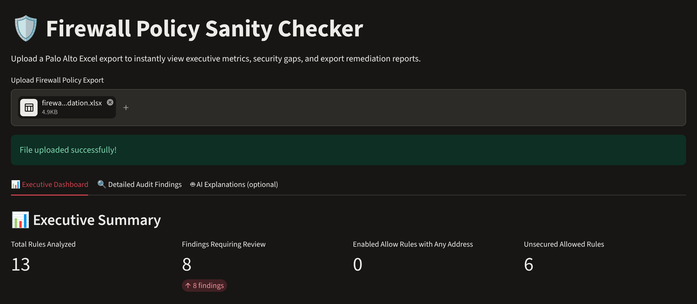
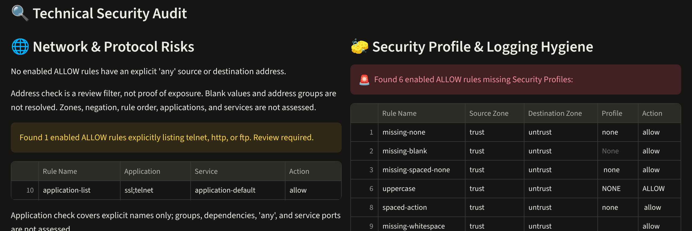
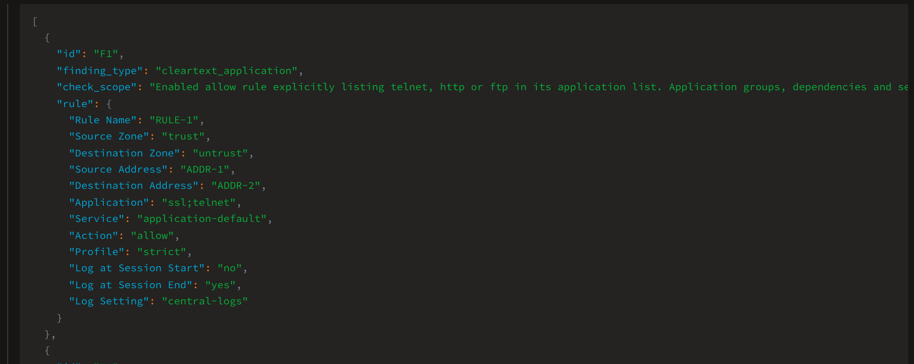
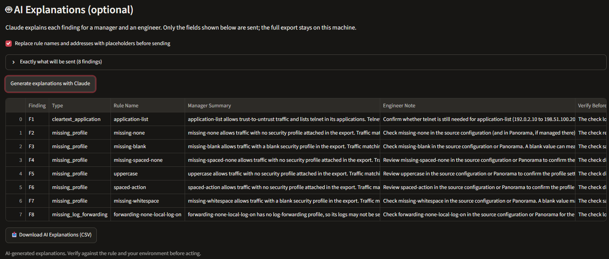

# Firewall Policy Sanity Checker

A read-only Python and Streamlit tool for reviewing Palo Alto Networks security-policy spreadsheet exports. It surfaces defined review candidates, displays summary counts and rule details, and generates an Excel report for engineering review.

Developed by Dave Durand / A1 Cyber Services LLC.

**Deterministic Python checks decide every finding. An optional, opt-in tab uses Claude (Anthropic API) to explain those findings; it never decides what is a finding.**

## Screenshots

Synthetic sample data only.

**Executive dashboard**



**Detailed findings**



**AI tab: exact payload preview (rule names and addresses replaced with placeholders)**



**AI tab: live Claude explanations, names restored locally**



## Status

The corrected implementation has been exercised with synthetic data through offline tests, the Streamlit dashboard, and browser-downloaded Excel reports. It has not been validated against production exports in this development cycle.

This package contains `app.py`, the optional `ai_explainer.py` module, a synthetic sample workbook, repeatable offline tests, and recorded validation results. The AI module is tested offline with a simulated Claude client and was exercised once live (claude-sonnet-5-5) against the synthetic workbook: all 8 findings were explained, with rule names and addresses sent as placeholders and restored locally. Live output quality depends on the model and should be reviewed.

## What it checks

| Check | Rules considered | Finding condition |
| --- | --- | --- |
| Broad address selection | Enabled allow rules | Source Address or Destination Address is explicitly `any` |
| Explicit application names | Enabled allow rules | Application contains an exact `telnet`, `http`, or `ftp` token |
| Missing security-profile attachment | Enabled allow rules | Profile is blank, whitespace, or `none` |
| Session logging disabled | Enabled rules, including deny rules | Both session-start and session-end logging flags are explicitly off |
| Missing forwarding profile | Enabled rules, including deny rules | Log Setting is blank, whitespace, or `none` |
| Unknown session-logging state | Enabled rules | Either session-logging flag is blank or unrecognized |

The application check accepts semicolon, comma, or whitespace separators, including line breaks. Matching ignores capitalization and surrounding whitespace. For example, `ssl;telnet` matches; `sftp` and `telnet-custom` do not.

Address matches are review candidates, not proof of network exposure. A named profile indicates attachment only; the tool does not verify its contents or effectiveness.

## Optional AI explanations

The **🤖 AI Explanations (optional)** tab sends the findings from the checks above to Claude and returns, for each finding:

- **Manager summary**: why it matters, in plain language.
- **Engineer note**: what to review in the rule or Panorama.
- **Verify before change**: what the check did not assess and must be confirmed first.

How data is limited:

- Only these fields from finding rows are sent: Rule Name, Source/Destination Zone, Source/Destination Address, Application, Service, Action, Profile, session logging flags, and Log Setting. The full export, UUIDs, and all other columns stay local.
- By default, rule names and non-`any` address values are replaced with placeholders (`RULE-1`, `ADDR-1`) before sending and mapped back locally in the results.
- The tab shows the exact JSON that will be sent before you click **Generate**.
- Each finding carries the check's scope statement, so the model is told what was and was not assessed.
- At most 25 findings are sent per request to bound cost.

Enable it by setting an API key in your shell before starting Streamlit (never commit keys):

```powershell
$env:ANTHROPIC_API_KEY = "sk-ant-..."     # PowerShell
# optional: $env:ANTHROPIC_MODEL = "claude-haiku-5-5"   (default: claude-sonnet-5-5)
streamlit run app.py
```

Without a key, the tab shows the data preview and an instruction; the rest of the app is unaffected. AI output is advisory and must be verified before any change.

## Local setup

The corrected version was tested on Windows with Python 3.13. Run these commands from the project folder after saving the corrected implementation as `app.py`:

```powershell
python -m venv .venv
.\.venv\Scripts\python.exe -m pip install streamlit pandas openpyxl
.\.venv\Scripts\python.exe -m streamlit run app.py --server.address 127.0.0.1 --server.headless true --browser.gatherUsageStats false
```

Open the local URL printed by Streamlit. Keeping the server bound to `127.0.0.1` limits access to this computer. Stop the server with `Ctrl+C` in its terminal.

Direct dependencies are Streamlit, pandas, and openpyxl. `requirements.txt` pins the tested environment, including transitive dependencies, for Windows/Python 3.13. Other operating systems and Python versions have not been verified.

## Spreadsheet format

- File type: `.xlsx`.
- Worksheet name: `firewall`, exactly.
- Row 1: title or other metadata; the importer skips it.
- Row 2: column headers, exactly as listed below.
- Row 3 onward: one security-policy rule per row.

| Required column | Expected content |
| --- | --- |
| UUID | Rule identifier; preserve uniqueness across the exported scope |
| Rule Name | Rule name |
| Source Address | Explicit address value, object, or group name |
| Destination Address | Explicit address value, object, or group name |
| Application | Application name or delimited list |
| Service | Exported service selection |
| Action | Exported action; `allow` is required for the first three checks |
| Profile | Attached security profile/group name, or blank/`none` |
| Log Setting | **Log-forwarding profile name**, or blank/`none` |
| Source Zone | Exported source zone selection |
| Destination Zone | Exported destination zone selection |
| Disabled | `yes`/`no`, `true`/`false`, or `1`/`0` |
| Log at Session Start | `yes`/`no`, `true`/`false`, or `1`/`0` |
| Log at Session End | `yes`/`no`, `true`/`false`, or `1`/`0` |

For Disabled, a true value means the rule is disabled and is excluded from the checks. For session-logging flags, a true value means that logging option is enabled. Capitalization and surrounding whitespace are normalized.

**Confirm the export's column meanings before use.** In particular, `Log Setting` must represent the forwarding profile, not a combined description of logging options. The tool does not automatically map different export formats.

Missing required inputs can stop processing with an on-screen error. A missing or unknown Disabled state stops analysis. Blank or unrecognized session flags produce an unknown-state finding. Blank application/address values are not resolved and must not be interpreted as proof of safety.

## Review and export

1. Upload the spreadsheet in the local dashboard.
2. Review the Executive Dashboard and Detailed Audit Findings tabs.
3. Compare findings with the original policy context before proposing changes.
4. Select **Download Remediation Excel Report** to download `firewall_remediation_report.xlsx`.

The output worksheet is `Remediation Action Items`. It contains the original columns for matching rows, deduplicated by **UUID + Rule Name**. It does not add a finding-reason column; use the dashboard's category tables to understand each match.

The summary's **Findings Requiring Review** adds category counts. One rule can match multiple categories, so this number can exceed the number of unique rows exported. Unknown logging states and missing forwarding attachments are included as review findings, not confirmed vulnerabilities.

## Validation performed

Offline cases covered missing profiles, application-list matching, session logging versus forwarding, broad address selection, and invalid inputs. Each correction also received dashboard and downloaded-report verification using the same 13-rule synthetic workbook.

For the final corrected version, the synthetic workbook produced:

| Result | Expected and observed |
| --- | ---: |
| Rules loaded | 13 |
| Enabled allow rules with an explicit `any` address | 0 |
| Missing-profile findings | 6 |
| Explicit application-name findings | 1 |
| Rules with both session-logging flags disabled | 0 |
| Missing forwarding-profile findings | 1 |
| Unknown session-logging states | 0 |
| Unique rules in downloaded Excel | 8 |

The `application-list` rule containing `ssl;telnet` was included. The `deny-any-address` and `disabled-missing` rules were excluded from the final report. Separate offline address cases exercised positive `any` matches; the dashboard workbook's address result is zero.

These are focused synthetic checks, not a claim of comprehensive test coverage. The package includes `sample-data/firewall-synthetic-validation.xlsx`, a portable test suite, and pinned dependencies. Run the tests from the repository root:

```powershell
.\.venv\Scripts\python.exe -m unittest discover -s tests -v
```

Tests record Streamlit UI calls while executing the actual app, read the real sample workbook, and reopen its in-memory Excel export. They do not automate a browser. Recorded browser verification is included under `validation/`.

## Read-only PAN-OS ingest (`panos_source.py`)

Builds the same `firewall` workbook the dashboard reads, directly from a firewall/Panorama or a saved config file. `app.py` and the checks are unchanged.

```powershell
# Live, read-only. Use an API key for a read-only admin role; it is sent in the X-PAN-KEY header.
$env:PANOS_API_KEY = "<key>"
python panos_source.py --host pano.lab.local --device-group Branches --ca-bundle lab-ca.pem --out rules.xlsx
python panos_source.py --host fw.lab.local --vsys vsys1 --out rules.xlsx

# Offline, from an exported running-config
python panos_source.py --xml-file running-config.xml --device-group Branches --out rules.xlsx
```

- Sends only `type=config` with `action=show` (running, default) or `action=get` (`--candidate`). Any other action is refused in code.
- Panorama: reads shared pre, device-group pre, device-group post and shared post rulebases, in that order. Parent device groups are not walked yet.
- Members are joined with `;`. Absent elements take PAN-OS defaults (disabled `no`, log-start `no`, log-end `yes`).
- Profile is the group name, or `type=name` pairs for individual profiles; blank when none is attached.
- Adds `Rulebase`, `Position`, `Negate Source` and `Negate Destination` columns for review context. The checks ignore them.
- `--insecure` disables TLS verification and is meant only for an isolated lab.

## Scope and limitations

- The dashboard reads an uploaded workbook. `panos_source.py` can read a device over the XML API using only show/get. Nothing creates, modifies, deletes, commits, or pushes configuration.
- Does not resolve parent device-group inheritance or calculate effective policy. Rule order is recorded (`Rulebase`, `Position`) but not evaluated.
- Does not assess address/application groups, dependencies, negation, rule order, shadowing, NAT, routing, or effective reachability.
- The explicit application list is limited to `telnet`, `http`, and `ftp`. It does not establish whether all cleartext traffic is blocked; `any`, other App-IDs, and service ports require separate review.
- Does not inspect security-profile contents, log-forwarding destinations, actual log generation, or delivery to Panorama/syslog.
- A named forwarding profile is not evidence of successful forwarding. Both session flags being off concerns session traffic logging; it does not establish that every other log type is disabled.
- Export deduplication uses UUID + Rule Name only. Scope collisions or incomplete identifiers can collapse distinct rows; prepare exports accordingly.
- Findings require engineering review. Zero findings means no matches for these implemented checks, not a secure or compliant policy.

## Data handling

Use synthetic or appropriately sanitized workbooks for demonstrations and repository samples. Run the app locally and keep production exports, credentials, and generated reports out of GitHub. External calls occur only when you click **Generate explanations with Claude**; they send the previewed findings to Anthropic's API. Do not enable redaction-off mode with production data unless your data-handling policy allows it. Uploaded data is processed by the running local app; downloaded reports retain the selected input fields and should be handled accordingly.

## Planned next steps

- Validate an agreed real export format using sanitized data.
- Validate `panos_source.py` against a lab Panorama and a sanitized production config.
- Walk parent device groups; add shadowed-rule and zero-hit-count checks.
- Review live Claude explanations against sanitized real findings and refine the prompt.
